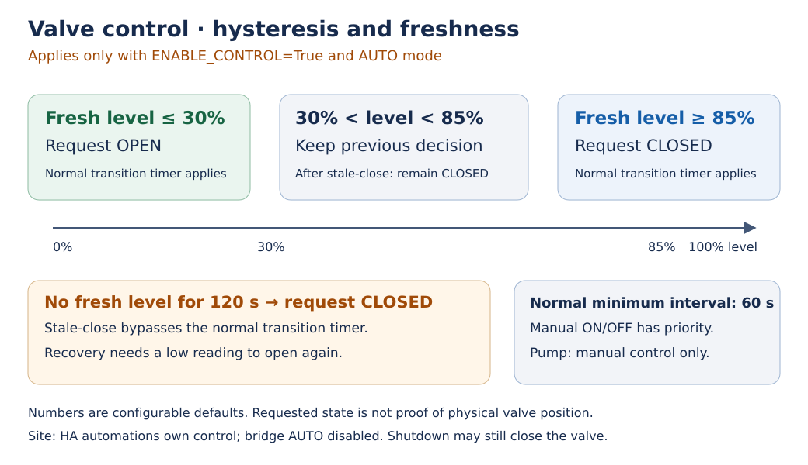

# Control ownership and failure behavior

[Operator guide](README.md) · [Configuration](configuration.md) · [Troubleshooting](troubleshooting.md)

## Ownership comes before automation

The configured installation has active HA automations for pump/valve control.
Keep `ENABLE_CONTROL=False` there unless the operator deliberately transfers
automatic ownership. The bridge has no cross-host lock or arbitration with HA,
Node-RED, desktop clients or other writers. Distinct D-Bus instances do not
prevent competing commands to one switch.

`ENABLE_CONTROL=False` suppresses automatic decisions; **it does not make the
bridge incapable of actuation**. Explicit `/Mode` requests and the shutdown
valve-close action remain active. The pump has manual control only. Its AUTO
mode does not implement a pump schedule or level policy.

## Valve AUTO

With automatic control enabled, a fresh normalized level at or below
`VALVE_START_VALUE` requests opening; at or above `VALVE_STOP_VALUE` it requests
closure. Between the thresholds the controller retains its previous decision.
Normal transitions respect `MIN_SWITCH_INTERVAL`. The defaults are 30%, 85%
and 60 seconds.

Missing, unavailable or non-finite level data does not refresh the monotonic
freshness deadline. After `SENSOR_STALE_TIMEOUT` (default 120 seconds), AUTO
requests closure without waiting for the normal switching interval. The
application does not blindly actuate an entirely unknown initial valve state.
An HA acknowledgement is not proof of physical closure; check subsequent
telemetry and the installation's physical safeguards.

Stale closure clears the previous open decision. Recovery inside the hysteresis
band keeps the valve closed. Reopening requires fresh evidence at/below the
start threshold and the normal interval since closure. Repeated stale samples
do not extend that interval. Poll request start time, rather than delayed
callback delivery, determines evidence age.

## Manual modes and the command queue

`/Mode` accepts only integral numeric values `0` AUTO, `1` ON and `2` OFF.
Booleans, all floats (including `1.0`), strings, lists and out-of-range values
are rejected. Manual ON intentionally overrides
the automatic level/stale policy; use it under operator supervision. Returning
to AUTO re-evaluates cached data without pretending it is fresh, when automatic
control is enabled.

A single worker performs HA network operations. Polls do not overlap and cannot
block D-Bus reads or main-loop freshness checks. The command queue holds at most
eight operations; a full queue rejects a new mode write. A successful write
means queued, while `/State` is updated after HA acknowledgement/telemetry.
New requests supersede older queued requests for the same switch. A request
already sent to HA cannot be cancelled; an opposite safety decision is queued
after it and retried when necessary.

## Shutdown, outages and limits

Graceful shutdown discards pending work, finishes the active request and then
attempts to close the valve through the same worker. The wait is bounded to
15 seconds; exceeding it logs unconfirmed closure. This applies even with
`ENABLE_CONTROL=False`, so a restart is not a non-actuating health probe.

A hard power loss cannot send a close request. Unreachable HA, networking loss,
a failed relay or valve mechanics can prevent closure. Use appropriate physical
protection such as a normally closed valve/interlock where required. Software
telemetry and mocked tests cannot establish the physical installation's safety.

The bridge is scoped to the configured water switches; it must not control ESS
setpoints, chargers, thermostats or unrelated relays. Read
[architecture and trust boundaries](../architecture.md) for implementation scope.

## Development dry run

In this development revision, `--dry-run` forces the off-device D-Bus stand-in,
never publishes live services or sends switch commands, closes its HA session,
and reports normalized tank/switch values in memory (volume paths use m³).
It reads one HA snapshot using configured credentials and does not update the
real service heartbeat. Older releases did not fully isolate dry-run actuation/registration;
do not assume this guarantee when running an older installed package.
