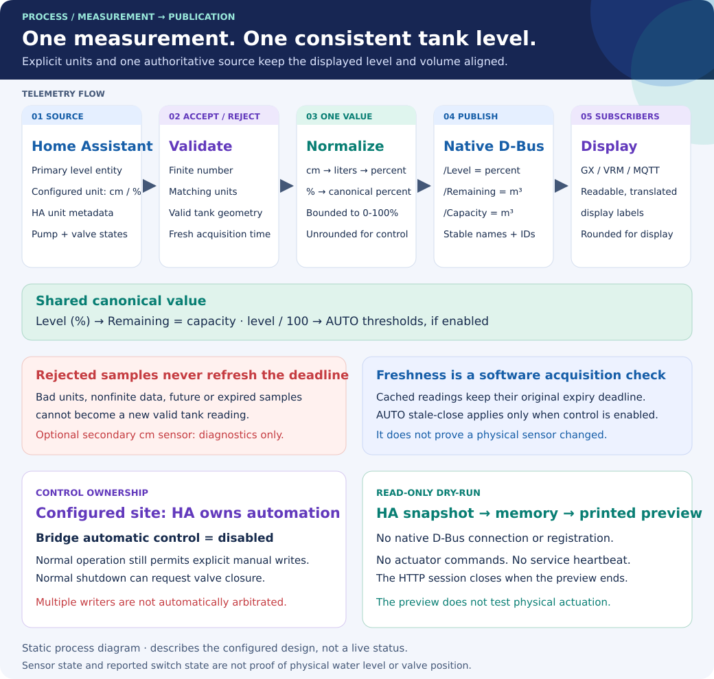
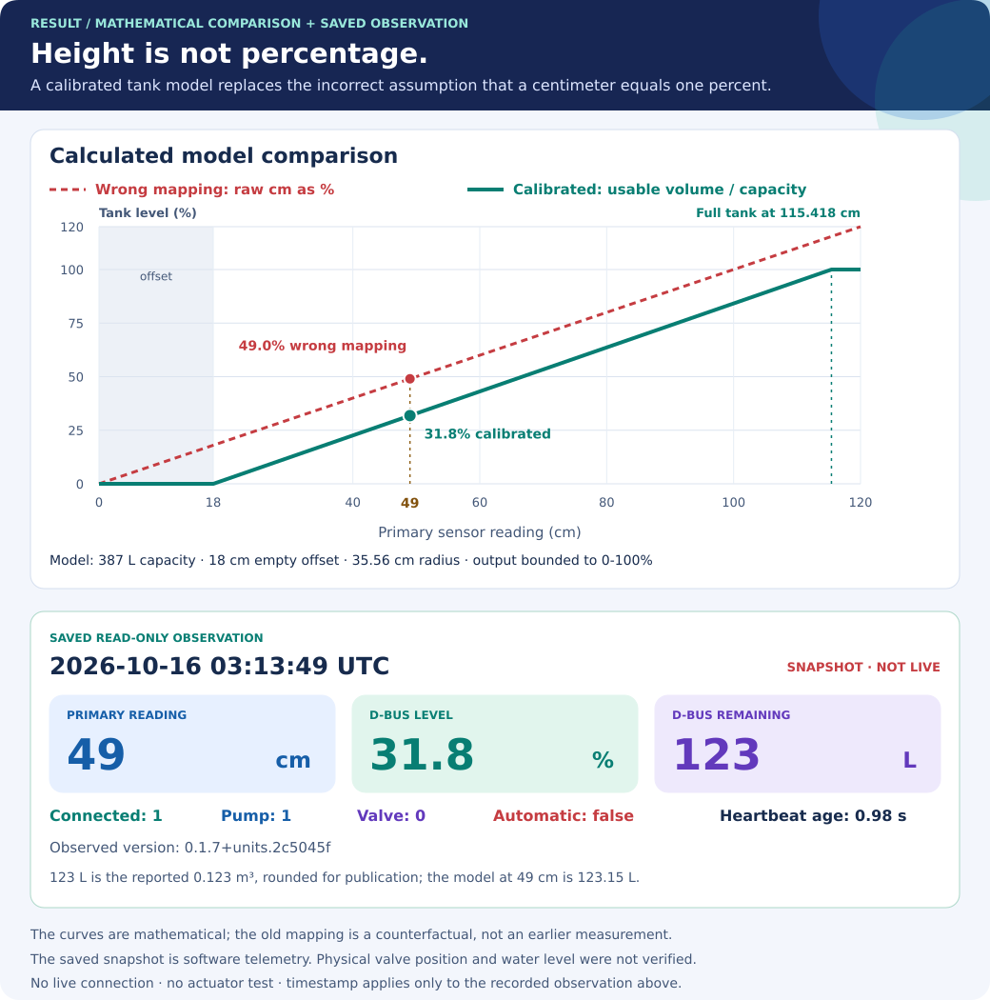

# From a Home Assistant reading to a verified tank display

[Operator guide](README.md) · [Calibration](calibration.md) · [Control](control.md)

This guide follows the measurement through the bridge and records one dated,
read-only check on a Cerbo GX. The deployed runtime was the development build
`0.1.7+units.2c5045f`, from commit
`2c5045fb298e4f3428cb34c4775960d43e2ffc52`. It is not a stable-release acceptance
record. Repository changes and their GitHub checks are tracked in
[PR #116](https://github.com/victron-venus/dbus-pump/pull/116), which includes
[PR #117](https://github.com/victron-venus/dbus-pump/pull/117).

## Follow the measurement



1. **Read the source and its unit.** One batched Home Assistant request reads
   `sensor.water_level_2_water_level`, its unit attribute and the pump/valve
   states. The pump entity for this installation is `switch.pump_power_enable`.
   These are site-specific entity IDs, not defaults for another installation.
2. **Validate before using the reading.** `HA_WATER_LEVEL_UNIT` explicitly selects
   `cm` or `%`. Nonempty HA unit metadata must agree. Invalid or nonfinite data
   cannot renew the last valid reading's freshness deadline. Configuration must
   provide valid geometry before the services are registered.
3. **Normalize once.** In `cm` mode, subtract the empty-reading offset and use the
   configured vertical-cylinder cross-section to calculate volume and percentage.
   Clamp the result to the tank's usable range. The primary sensor drives both
   outputs; the optional secondary centimetre entity is diagnostic only.
4. **Publish consistent values.** `/Level` is percent; `/Remaining` and `/Capacity`
   are cubic metres. Display rounding does not change the unrounded value used
   for control decisions. Translated labels use the selected `LANGUAGE`; service
   IDs, paths and numeric values are unchanged across EN, RU, DE and NL.
5. **Check the running system.** Compare fresh HA and D-Bus readings, connectivity,
   heartbeat and observed switch states. A running process alone does not prove
   that the displayed measurement is correct.

Telemetry and actuation have separate responsibilities. At this installation,
HA automations own actuation and `ENABLE_CONTROL=False`. That disables automatic
bridge decisions; it does not disable explicit manual D-Bus commands or the
normal shutdown close request. The updated `--dry-run` reads one snapshot into
in-memory services and sends no equipment commands, registers no native D-Bus
services and writes no heartbeat. See the [control contract](control.md).

## Understand the correction



The comparison curve is a calculation, not a recording of historical readings.
It illustrates why passing a centimetre value directly to a percentage display
is wrong. For the configured **387 L** cylinder with **35.56 cm** radius and
**18 cm** empty-reading offset:

```text
usable height = 49 - 18 = 31 cm
volume = 31 × π × 35.56² / 1000 = 123.15018572 L
level = 123.15018572 / 387 × 100 = 31.82175342%
```

Interpreting the raw number as percent would display **49%**, an overstatement
of **17.18 percentage points** at this sample. The actual corrected D-Bus display
was **31.8%** and **0.123 m³ (123 L)**. Geometry is configuration supplied by the
operator; the calculation does not independently establish the physical tank's
shape, sensor calibration or actual water volume.

## Recorded result

At **2026-10-16 03:13:49 UTC**, a read-only SSH check polled HA with the installed
client, independently calculated the expected percentage with the installed
normalizer, and read the running services through D-Bus `GetValue`:

- Primary HA reading: **49 cm**.
- Expected percentage: **31.821753415983423%**; running `/Level`: **31.8%**.
- Running `/Remaining`: **0.123 m³**; tank `/Connected`: **1**.
- Pump `/State`: **1**; valve `/State`: **0**. These are reported states, not
  independently observed flow or physical valve position.
- Heartbeat age: **0.98 s**; automatic bridge control remained **disabled**.
- Local and installed configuration hashes matched. No configuration was
  changed and no pump/valve command was issued during this check.

The [machine-readable record](../evidence/cerbo-unit-verification-2026-10-16.json)
contains the observed values and the acceptance tolerances. It is a static
snapshot, not live monitoring. Earlier log entries included transient HA
connection refusals/timeouts; the successful sample establishes recovery at
the stated time, not uninterrupted availability.

## Reproduce the check at your installation

First verify the entity IDs, explicit unit, tank dimensions and actuation owner.
Follow [installation and rollback](installation.md) for backups and deployment.
Use the documented read-only preview before considering any switch command:

```sh
cd /data/dbus-pump
python3 -m dbus_pump --dry-run
svstat /service/dbus-pump-ha /service/dbus-pump-ha/log
tail -n 40 /var/log/dbus-pump-ha/current
```

Then compare the running `/Level`, `/Remaining`, `/Connected` and heartbeat with
a fresh HA sample. A preview reports its own in-memory view; it does not by
itself verify the already-running service. Allow for display rounding and for a
real sensor changing between the two reads. Investigate stale or inconsistent
values with the [troubleshooting guide](troubleshooting.md).

This check did not exercise a reboot, physical calibration, automatic filling,
manual actuation or network-failure drills. Those require their own explicit
procedure and evidence; repository tests and a healthy telemetry sample do not
substitute for them.
