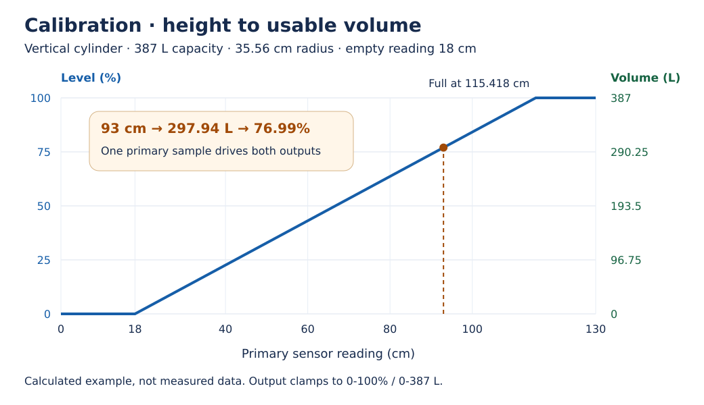

# Calibration

[Wiki home](Home.md) · [Configuration](Configuration.md)

A sensor reporting `93 cm` cannot be published directly as `93%`.
For a vertical cylinder, subtract the reading at empty, multiply usable height
by `π × radius²`, then convert cm³ to liters. Clamp liters between zero and
capacity and divide by capacity to obtain percent.

With an 18 cm offset, 35.56 cm radius and 387 L capacity, 93 cm gives approximately
**297.94 L and 76.99%**. D-Bus rounds this to roughly `/Level=77.0` and
`/Remaining=0.298` m³. This is a calculation using configured inputs, not a recorded
physical calibration test.

The model assumes a vertical cylinder and a reading that increases with water
height. Horizontal/irregular tanks need their own normalized percent source;
distance-to-surface sensors first need conversion to water height. Unknown level
is unavailable, not zero liters. Invalid units/calibration must be corrected,
not compensated for with different control thresholds.

[Full calibration procedure and migration notes](../operator/calibration.md).
