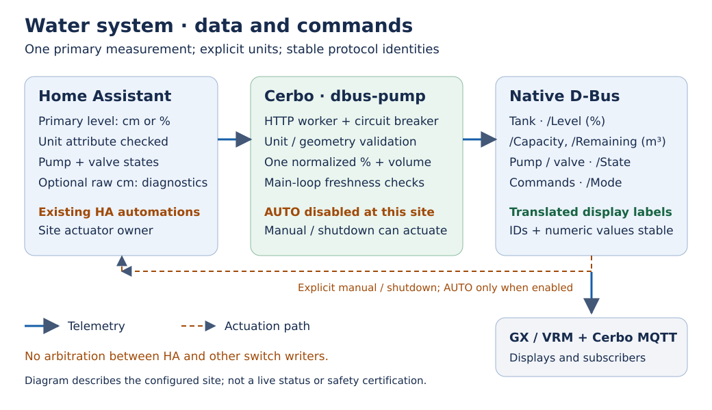

# dbus-pump wiki

**Version scope:** unit normalization, runtime localization and stricter command
validation documented here are unreleased development changes. Use this source
revision or a release explicitly containing them; older releases differ.

A Home Assistant bridge for the tank, pump and valve on Victron Venus OS.
It publishes native D-Bus services and Cerbo MQTT telemetry. Source units are
explicit: a centimetre measurement is converted using calibrated vertical-cylinder
geometry before it becomes a percentage.

## Read in your language

[English](../../README.md) · [Русский](../../README.ru.md) ·
[Deutsch](../../README.de.md) · [Nederlands](../../README.nl.md)

The READMEs cover setup and operation in all four languages. Detailed wiki and
operator pages currently use English. Runtime display labels also support
English, Russian, German and Dutch without changing protocol identities.

## Operator pages

1. [Installation](Installation.md): dependencies, paths, updates and recovery.
2. [Configuration](Configuration.md): primary source unit, entities and D-Bus.
3. [Calibration](Calibration.md): cm → liters → %, worked example and limitations.
4. [Control and safety](Control-and-safety.md): ownership, manual modes and stale data.
5. [Troubleshooting](Troubleshooting.md): observe first, diagnose without toggling.
6. [Localization](Localization.md): runtime language and translation contributions.
7. [Process and results](Process-and-results.md): the conversion path and a dated Cerbo check.

The configured site runs HA automations for the water system and keeps bridge
`ENABLE_CONTROL=False`. That flag suppresses AUTO only; manual commands and
shutdown closure remain possible. The bridge does not arbitrate between writers.

[Project README](../../README.md) · [Architecture](../architecture.md) ·
[Contribution guide](../../CONTRIBUTING.md) · [Release process](../../RELEASING.md) ·
[Security](../../SECURITY.md) · [Evidence](../quality-evidence.md)

These pages are maintained in `docs/wiki` alongside the code. See
[wiki publishing instructions](README.md) for preparing a reviewed wiki checkout.
